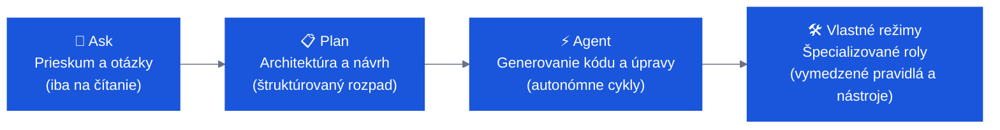

# IBM Bob — Workshop na STU FEI

Vitajte na praktickom workshope **IBM Bob** na STU FEI! Toto je váš kompletný sprievodca — vyberte si úroveň, postupujte podľa podrobných inštrukcií a vytvorte reálne aplikácie s pomocou IBM Bob.

---

## Vyberte si úroveň

<div class="grid cards" markdown>

-   :material-numeric-1-circle:{ .lg .middle } __[🟢 Začiatočník](labs/openslava-beginner.md)__

    ---

    **~70 min · 3 laby · Nevyžadujú sa predchádzajúce skúsenosti s Bobom**

    Vytvorte aplikáciu s konfetami, pridajte podporu medzipristátí do full-stack cestovnej aplikácie a integrujte výber dátumov spolu s mock AI rezervačným agentom — vyskúšate si režimy **Ask**, **Plan** a **Agent**.

    [:octicons-arrow-right-24: Začať úroveň Začiatočník](labs/openslava-beginner.md)

-   :material-numeric-2-circle:{ .lg .middle } __[🟡 Pokročilý](labs/openslava-intermediate.md)__

    ---

    **~70 min · 2 laby · Predpokladá sa základná znalosť Boba**

    Prejdite si kompletný cyklus **Issue → Vetva → Kód → PR** pomocou GitHub MCP, potom vytvorte a commitnite verzované tímové pravidlá, ktoré Bob automaticky uplatňuje pri každej interakcii.

    [:octicons-arrow-right-24: Začať úroveň Pokročilý](labs/openslava-intermediate.md)

-   :material-numeric-3-circle:{ .lg .middle } __[🔴 Expert](labs/openslava-expert.md)__

    ---

    **~90 min · 4 laby · Pre pokročilých používateľov a architektov**

    Preskúmajte kódovú bázu bankového systému, vytvorte React UI, vykonajte bezpečnostný audit, napíšte pravidlá pre fintech compliance, vytvorte vlastný špecializovaný režim a automatizujte celý SDLC cez GitHub MCP.

    [:octicons-arrow-right-24: Začať úroveň Expert](labs/openslava-expert.md)

-   :material-trophy:{ .lg .middle } __[🏆 Výzva](labs/openslava-challenge.md)__

    ---

    **Otvorený vývoj · Prví 3 úspešní riešitelia získajú odmenu**

    Vytvorte **PocketLedger** — full-stack aplikáciu na sledovanie osobných financií — s využitím všetkých schopností Boba, ktoré ste sa naučili: `/init`, pravidlá, vlastný režim a kompletný GitHub issue-to-PR cyklus. Hodnotia sa všetky vytvorené Bob artefakty.

    [:octicons-arrow-right-24: Prijať výzvu](labs/openslava-challenge.md)

</div>

---

## Režimy IBM Bob v skratke



---

## Požiadavky a inštalácia

### 1 — Získajte IBMid

IBM Bob vyžaduje IBMid. **IBMid je bezplatné** — vytvorte si ho na [ibm.com/account/reg](https://www.ibm.com/account/reg/us-en/signup?formid=urx-19776) (trvá to ~2 minúty). Ak už IBMid máte, tento krok preskočte.

### 2 — Nainštalujte IBM Bob

IBM Bob je **samostatné IDE** — nie rozšírenie pre VS Code. Stiahnite si ho z [bob.ibm.com/download](https://bob.ibm.com/download) a pri prvom spustení sa prihláste pomocou svojho IBMid.

=== "IBM Bob IDE (odporúčané)"
    Stiahnite si inštalátor pre váš operačný systém z **[bob.ibm.com/download](https://bob.ibm.com/download)**:

    | OS | Inštalátor |
    |---|---|
    | macOS (Apple Silicon) | `.pkg` — mac-ARM |
    | macOS (Intel) | `.pkg` — mac-intel |
    | Windows | `.exe` |
    | Linux (Debian/Ubuntu) | `.deb` |
    | Linux (Red Hat/Fedora) | `.rpm` |

    Spustite inštalátor, postupujte podľa sprievodcu a pri prvom spustení sa prihláste pomocou **IBMid**.

=== "Bob Shell (terminál)"
    Preferujete prácu v termináli? Nainštalujte si Bob Shell:

    **macOS / Linux**
    ```bash
    curl -fsSL https://bob.ibm.com/download/bobshell.sh | bash
    ```
    **Windows (PowerShell)**
    ```powershell
    powershell -ep Bypass 'irm -Uri "https://bob.ibm.com/download/bobshell.ps1" | iex'
    ```
    Po výzve sa autentifikujte na `bob.ibm.com/login`.

### 3 — Ďalšie požiadavky

- Nainštalovaný **Node.js 20 LTS** a **Python 3.11+**
- Nakonfigurovaný **Git** (`user.name` a `user.email`)
- Aplikácia **Galaxium Travels** v priečinku `galaxium-travels/` — je už súčasťou repozitára, netreba ju klonovať samostatne *(pre úrovne Začiatočník / Pokročilý)*

---

## Užitočné odkazy

| | Odkaz |
|---|---|
| **IBM Bob** | [bob.ibm.com](https://bob.ibm.com) |
| **Dokumentácia** | [ibm.biz/bob-doc](https://ibm.biz/bob-doc) |
| **Blog** | [bob.ibm.com/blog/getting-the-most-out-of-bob](https://bob.ibm.com/blog/getting-the-most-out-of-bob) |
| **Registrácia IBMid** | [ibm.com/account/reg](https://www.ibm.com/account/reg/us-en/signup?formid=urx-19776) |
